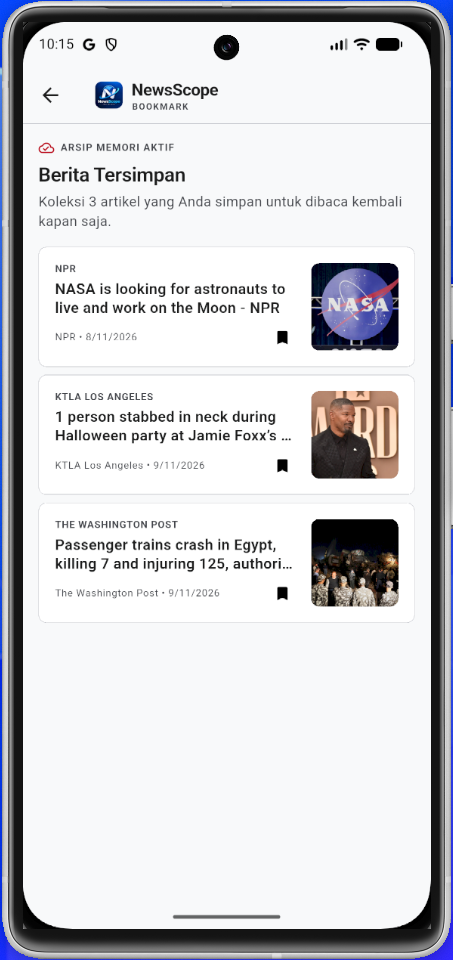

# 🌐 NewsScope

**Breaking News — Explore the World Through News.**

NewsScope is a Flutter-based news application designed to help users explore the latest available news through a clean, modern, and intuitive interface.

The application integrates with [NewsAPI.org](https://newsapi.org/) to retrieve news articles and provides features such as news browsing, category filtering, article search, bookmarks, and external article navigation.

---

## 📱 Application Preview

<!-- Replace these image paths with actual screenshots of the application. -->

| Home Page | Article Detail |
|:---:|:---:|
|  |  |

| Bookmark Page |
|:---:|
|  |

---

## ✨ Features

- **News Feed** — Browse news articles from the NewsAPI service.
- **Category Filtering** — Explore articles by category.
- **Search Articles** — Find articles using keywords.
- **Article Details** — Read article descriptions and information.
- **Bookmark** — Save favorite articles for later.
- **External Browser** — Open the original article through an external browser.
- **Responsive UI** — A clean interface designed for a comfortable reading experience.
- **Error Handling** — Loading, empty, and error states with retry support.

---

## 🛠️ Built With

| Technology | Purpose |
|---|---|
| Flutter | Cross-platform application framework |
| Dart | Programming language |
| Provider | State management |
| NewsAPI.org | News data provider |
| HTTP | API communication |
| URL Launcher | Open articles externally |
| Material 3 | UI design system |

---

## 📂 Project Structure

```text
lib/
├── models/
├── providers/
├── screens/
├── services/
├── theme/
├── widgets/
└── main.dart

assets/
├── images/
└── mock/

docs/
└── screenshots/

test/
```

---

## 🚀 Getting Started

### Prerequisites

Before running this project, make sure you have installed:

- [Flutter SDK](https://docs.flutter.dev/get-started/install)
- [Dart SDK](https://dart.dev/get-dart)
- [Git](https://git-scm.com/)
- A code editor such as VS Code or Android Studio.

### 1. Clone the Repository

```bash
git clone https://github.com/Asyamfaw/NewsApp.git
```

Navigate to the project directory:

```bash
cd NewsApp
```

### 2. Install Dependencies

```bash
flutter pub get
```

### 3. Configure NewsAPI

This project uses [NewsAPI.org](https://newsapi.org/) to retrieve news articles.

You need your own API key to run the application.

1. Create an account at [NewsAPI.org](https://newsapi.org/register).
2. Get your API key from your NewsAPI dashboard.
3. Copy the example environment file:

```bash
cp env.example.json env.json
```

4. Open `env.json` and replace the placeholder with your API key:

```json
{
  "NEWS_API_KEY": "YOUR_API_KEY"
}
```

**Important:**
- Never upload `env.json` or expose your API key publicly.
- The actual `env.json` file is excluded through `.gitignore`.
- Use your own API key when running the application.

### 4. Run the Application

```bash
flutter run --dart-define-from-file=env.json
```

### 5. Run Tests

To execute the automated tests:

```bash
flutter test
```

To analyze the project:

```bash
flutter analyze
```

---

## 👥 For My Friends

If you want to clone this project and try it on your own device, feel free!

A few things to remember:

1. Make sure Flutter and Dart are installed correctly.
2. Install all project dependencies using `flutter pub get`.
3. Create your own NewsAPI account and use your own API key.
4. Create your local `env.json` file by following the API configuration instructions above.
5. Run the application using the provided command.

**Please don't use someone else's API key.** Each developer should configure their own API credentials.

Also, keep in mind that the free NewsAPI Developer plan has limitations, including a daily request quota and a delay in article availability. Check the current terms on the [NewsAPI documentation](https://newsapi.org/docs).

---

## 👨‍💻 Author

**Asyam Mahdi Fawwaz**

Software Developer Student | Web Development Enthusiast

[](https://github.com/Asyamfaw)

---

## 📄 License

This project was developed for educational purposes.

News data is provided by [NewsAPI.org](https://newsapi.org/).